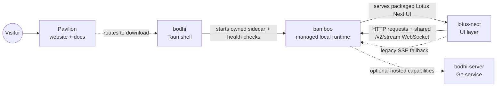

# Pavilion · Official Website & Docs Surface

> 📖 中文版请看 **[README.zh-CN.md](./README.zh-CN.md)**

> Pavilion is where the Zenith stack tells its story to the outside world — the official website that explains Bodhi AI, the desktop agent, in plain language: what it does, why it matters, where to download it, and how to get started.

---

## Start here

Pavilion brings product explanations, downloads, and getting-started docs into one place for people exploring a local AI agent harness. To run an agent, start with [Bodhi downloads](https://github.com/bigduu/Bodhi-AI/releases/latest) or [Bamboo](https://github.com/bigduu/Bamboo-agent). This repository is for editing the website, checking bilingual copy, and previewing documentation locally.

The guide describes the inspected source and build workflow. It does not establish which features are in every product release. Homepage screenshots are captured from the desktop app.

The Zenith architecture below describes current product source. Public pages treat Lotus Next as the product UI and Zenith as eight pinned submodules. Legacy Lotus is a pinned rollback, not a second product track. The linked [architecture deep-dive](./articles/zenith-architecture-overview.md) is historical: its nine-module count and Lotus/Next parallel-track description belong to that earlier period. For current source setup, follow the [Lotus Next](https://github.com/bigduu/lotus-next), [Bamboo](https://github.com/bigduu/Bamboo-agent), and [Bodhi](https://github.com/bigduu/Bodhi-AI) repository guides.

---

## Key Capabilities at a Glance

| Capability | What it is |
|---|---|
| Four product surfaces | Home, Features, Download, and Docs, all driven by React Router client-side routing |
| Bilingual by design | One-click 中文 / English switch, remembers the preference and writes it into the URL (`?lang=zh`) |
| Real screenshots | Actual UI in `public/screenshots/` (chat, MCP, metrics, settings, etc.), not concept art |
| Article layer | Founder story, architecture overview, backend deep-dive, CI/CD, multi-agent collaboration |
| Static & shippable | Built by Vite into a pure static site, ready to host out of the box |
| Source-visible examples | Quickstart and API snippets are kept in `src/constants.ts` instead of being hidden in page components |

---

## Architecture

Pavilion is a plain React 19 + Vite 8 single-page app written in TypeScript. It has no backend of its own: the site copy lives in bilingual content dictionaries under `src/i18n/`, and the pages simply render it. Within Zenith's eight pinned submodules, Pavilion owns one boundary — the public website and documentation surface.

```
pavilion/
├── index.html              # SEO + Open Graph / Twitter meta
├── src/
│   ├── main.tsx            # entry
│   ├── App.tsx             # react-router route table (/ /features /download /docs)
│   ├── pages/              # HomePage / FeaturesPage / DownloadPage / DocsPage
│   ├── components/         # LanguageSwitch / SmartLink / RevealSection / SectionIntro
│   ├── hooks/useReveal.ts  # scroll-reveal
│   ├── i18n/               # zh.ts + en.ts bilingual content dictionaries
│   ├── utils/locale.ts     # locale detection & URL building
│   ├── constants.ts        # GitHub links, quickstart / API code examples
│   └── test/               # Vitest + Testing Library
├── articles/               # long-form Markdown
└── public/                 # favicon, og-cover, screenshots/
```

Current Zenith product architecture:



> This is the product/request path, not a complete submodule diagram. Bodhi starts and health-checks its owned `bamboo serve` sidecar. External-server reuse is limited to the explicitly selected legacy rollback path. In packaged builds, Bodhi loads the Lotus Next frontend served by Bamboo. Lotus Next sends requests over HTTP and receives live events through one shared `/v2/stream` WebSocket by default (JSON text by default, optional negotiated MessagePack). The legacy SSE endpoints are used only when WebSocket is explicitly disabled or its initial connection cannot be established. bodhi-server is an optional hosted service for account/auth, credential storage, model routing, billing/quota, and provider proxy capabilities; local Bodhi + Bamboo operation does not require it. Pavilion itself only links to the other repositories; it does not call the runtime or backend.

---

## Signature Deep-Dives

### The external narrative across four pages

Every surface reinforces one message: *Bodhi is a local desktop agent on your machine — not a web chat.* The home hero says that above the fold and sends the primary button to GitHub Releases. Features expands each capability, including safety and permissions. Download lists macOS, Windows, and Linux installers on the latest release. Docs carries first-run, architecture, API, and contributor tracks. All four are rendered from the bilingual dictionaries in `src/i18n/`. Unknown routes fall back to Home.

### Bilingual-first

Language is built into the architecture, not bolted on. `locale.ts` resolves the initial locale in order: the `?lang=` query param → `localStorage` (key `pavilion-locale`) → browser language (`zh*` → Chinese, else English). Switching language persists the choice and writes it back into the URL so links stay shareable. `LanguageSwitch` is a simple 中文 / EN toggle present on every page.

### The article layer

`articles/` holds long-form narratives and historical technical context (Markdown, primarily Chinese). References to “current” behavior in those articles describe their original writing period; use the product repository guides for current source and release-specific instructions. The architecture and release-system articles explicitly mark the legacy Lotus period.

| Article | What it covers |
|---|---|
| [`why-i-built-my-own-agent.md`](./articles/why-i-built-my-own-agent.md) | Why the founder decided to build an agent from scratch — the product's origin story |
| [`zenith-architecture-overview.md`](./articles/zenith-architecture-overview.md) | Historical product layers and responsibility boundaries from the legacy Lotus / parallel Lotus Next period |
| [`bodhi-server-deep-dive.md`](./articles/bodhi-server-deep-dive.md) | Optional hosted accounts, credential vault, billing/quota, model routing, and provider proxy capabilities in the Go backend |
| [`ci-cd-and-release-system.md`](./articles/ci-cd-and-release-system.md) | Historical legacy Lotus → Bamboo → Bodhi pipeline; links the current Zenith release playbook |
| [`multi-agent-collaboration.md`](./articles/multi-agent-collaboration.md) | Coordinating multiple agents working in parallel via the "Zenith Roadmap" GitHub Project |

---

## Quick Start / Development

Use Node.js 22.13+ within the 22.x line, or Node.js 24+, and npm. This satisfies the locked jsdom dependency's engine range. These scripts are defined in `package.json`.

```bash
git clone https://github.com/bigduu/Pavilion.git
cd Pavilion
npm ci

npm run dev       # start the Vite dev server
npm run build     # typecheck (tsc -b) + production build
npm run preview   # preview the built site
npm run lint      # ESLint
npm run test      # Vitest (vitest run)
```

Stack: React 19 · React Router 7 · Vite 8 · TypeScript 5.9 · Vitest 4 (see `package.json` for details).

---

## The Rest of the Stack

Zenith is a thin monorepo that currently pins eight submodules; Pavilion is its public-facing front door.

| Module | Role |
|---|---|
| [**bodhi**](https://github.com/bigduu/Bodhi-AI) | Tauri desktop shell that starts and health-checks its owned Bamboo sidecar; packaged builds load the Lotus Next UI served by Bamboo |
| [**bamboo**](https://github.com/bigduu/Bamboo-agent) | local-first Rust agent runtime (execution engine) |
| [**bodhi-server**](https://github.com/bigduu/bodhi-server) | optional hosted service for account/auth, credential storage, model routing, billing/quota, and provider proxy capabilities; not required for local Bodhi + Bamboo operation |
| **pavilion** | official website & docs (this module) |
| [**jiandu**](https://github.com/bigduu/Jiandu) | small filesystem-backed shared memory: Rust crate + stdio MCP server |
| [**nova**](https://github.com/bigduu/Nova) | native computer-use capabilities exposed through MCP |
| [**lotus-next**](https://github.com/bigduu/lotus-next) | canonical responsive React frontend; the old Lotus package is retained only as a release rollback option |
| [**magpie**](https://github.com/bigduu/Magpie) | IM connector and Bamboo service plugin |
| [**Zenith (root)**](https://github.com/bigduu/Zenith) | monorepo entry + submodule pointers + release train |

Install Bodhi from the terminal on Apple Silicon macOS or APT-based Linux x64.
The download page lists platform requirements and manual packages.
[Bodhi download page](https://bigduu.github.io/Pavilion/download?lang=en#terminal-install)

---

## GitHub Pages

The production host is the project site [https://bigduu.github.io/Pavilion/](https://bigduu.github.io/Pavilion/). `vite.config.ts` sets `base` to `/Pavilion/`, and the React Router basename follows that prefix. `npm run dev` and `npm run preview` also serve under `/Pavilion/`.

[`.github/workflows/deploy-pages.yml`](./.github/workflows/deploy-pages.yml) runs `npm ci`, `npm test`, and `npm run build` on pull requests and on pushes to `main`. Pushes to `main` upload `dist/` and deploy with GitHub Actions. The build copies `dist/index.html` to `dist/404.html` so a reload of `/Pavilion/features`, `/Pavilion/download`, or `/Pavilion/docs` still boots the client router.

### One-time Pages setting

This repository cannot turn Pages on by itself if the setting is still disabled. After this workflow is on `main`, a repository admin opens **Settings → Pages → Build and deployment** and sets **Source** to **GitHub Actions**. The next push to `main` (or a manual run of "Deploy GitHub Pages") publishes the site. Leave the repository website link on [Bodhi Releases](https://github.com/bigduu/Bodhi-AI/releases/latest) until that first deploy succeeds, then point it at `https://bigduu.github.io/Pavilion/`.

---

<sub>This root guide describes the repository; public site copy lives in `src/i18n/` and `articles/`.</sub>

Client routes are `/Pavilion/features`, `/Pavilion/download`, and `/Pavilion/docs`. GitHub Pages serves `404.html` (a copy of `index.html`) when those paths are reloaded. Historical articles provide context; use each product’s release notes for version-specific installation and behavior.

Source and version evidence: [audit notes](./docs/readme-audit.md).
